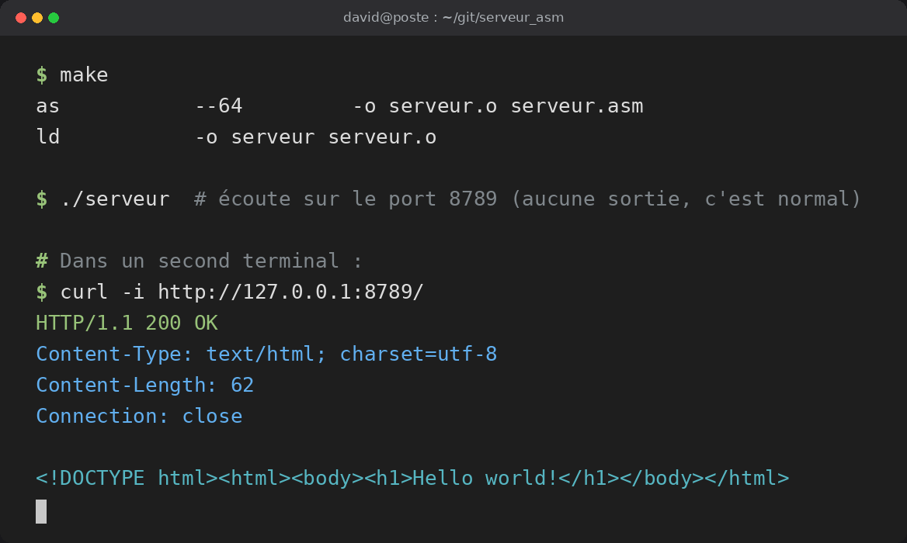
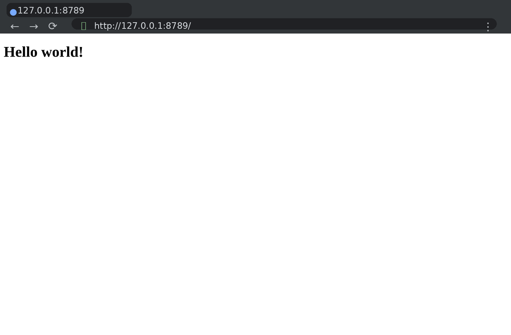

<div align="center">

# 🖥️ Serveur web en assembleur x86-64

**Un serveur HTTP minimaliste qui tient dans un seul fichier d'assembleur :
aucune bibliothèque, pas même la libc — uniquement des appels système Linux.**


**0 dépendance · 0 libc · port 8789 · réponse statique `Hello world!`**

</div>

---

## 🛠️ Stack technique

Le projet est une chaîne **assembleur + appels système**, pensée pour être
compilée et exécutée sans aucune bibliothèque externe :

- **[Assembleur x86-64](https://en.wikipedia.org/wiki/X86-64)** — tout le serveur (données et code) tient dans [`serveur.asm`](serveur.asm), en syntaxe Intel.
- **[GNU as](https://www.gnu.org/software/binutils/)** — assemble le texte en code machine (`as --64`).
- **[GNU ld](https://www.gnu.org/software/binutils/)** — lie le fichier objet en exécutable statique (`ld -o serveur serveur.o`), sans rien d'autre à lier.
- **[Appels système Linux](https://man7.org/linux/man-pages/man2/syscall.2.html)** — `socket`, `bind`, `listen`, `accept`, `read`, `write` et `close`, invoqués directement par l'instruction `syscall` (convention x86-64 : `rax` = numéro, `rdi`/`rsi`/`rdx` = arguments).
- **[GNU Make](https://www.gnu.org/software/make/)** — cibles `all`, `run` et `clean`, avec recompilation automatique si `serveur.asm` change.
- **[HTTP/1.1](https://httpwg.org/specs/rfc9112.html)** — la réponse est écrite à la main dans la section `.rodata` ; `Content-Length` est même calculé par l'assembleur (`reponse_fin - reponse`).
- **curl et un navigateur** — validation du serveur, sans outil supplémentaire.

> **Choix de conception** : aucun framework, aucun runtime, aucune dépendance à
> installer. Le binaire produit ne dépend que du noyau Linux.

## 📸 Captures et explications

### Console : compiler, lancer, tester



- **`make`** affiche les deux commandes réellement exécutées : `as` transforme
  `serveur.asm` en `serveur.o`, puis `ld` produit l'exécutable `serveur`.
- **`./serveur`** ne produit aucune sortie : c'est normal. Le programme se
  bloque volontairement dans `accept()` en attendant un visiteur.
- **`curl -i http://127.0.0.1:8789/`** montre la réponse brute : ligne de statut
  `HTTP/1.1 200 OK`, en-têtes (`Content-Type`, `Content-Length: 62`,
  `Connection: close`), puis le corps HTML.
- Une fois la réponse envoyée, le serveur ferme la connexion et retourne
  immédiatement dans la boucle pour le client suivant.

### Navigateur : la page servie



- La page est affichée à l'adresse **<http://127.0.0.1:8789/>** : c'est bien le
  binaire assembleur qui a répondu, sans serveur web intermédiaire.
- Le HTML renvoyé est volontairement minimal :
  `<!DOCTYPE html><html><body><h1>Hello world!</h1></body></html>`.
- Toutes les URL répondent la même page (`/`, `/foo`, `/index.html`, etc.) :
  la requête est lue pour vider le tampon, mais jamais analysée.

## 🚀 Démarrage rapide

Prérequis : Linux x86-64 avec [binutils](https://www.gnu.org/software/binutils/)
(`as`, `ld`) et, si possible, `make`. Aucun droit root n'est nécessaire, car le
port 8789 est supérieur à 1024.

```bash
make        # assemble et lie
make run    # compile si besoin puis lance le serveur
```

Sans `make` :

```bash
as --64 -o serveur.o serveur.asm
ld -o serveur serveur.o
./serveur
```

Laissez le serveur tourner dans un terminal, puis, dans un second terminal :

```bash
curl -i http://127.0.0.1:8789/
```

```http
HTTP/1.1 200 OK
Content-Type: text/html; charset=utf-8
Content-Length: 62
Connection: close

<!DOCTYPE html><html><body><h1>Hello world!</h1></body></html>
```

## 🔬 Fonctionnement

Le serveur tient en cinq appels système, dans une boucle sans fin :

| Étape | Appel système | Rôle |
|-------|---------------|------|
| 1 | `socket(AF_INET, SOCK_STREAM, 0)` | crée une prise réseau TCP |
| 2 | `bind(socket, &sockaddr, 16)` | attache la prise à `0.0.0.0:8789` |
| 3 | `listen(socket, 16)` | accepte les connexions entrantes |
| 4 | `accept(socket, NULL, NULL)` | attend un client et le prend en charge |
| 5 | `read` puis `write` puis `close` | vide la requête, envoie la réponse, raccroche |

La structure `sockaddr_in` (famille IPv4, port 8789 en big-endian, adresse
`0.0.0.0`) est définie directement dans `.rodata`, tout comme la réponse HTTP.
Le tampon de lecture de 1024 octets est réservé dans `.bss`.

## 📁 Structure du projet

```
serveur_asm/
├── Makefile        # compilation, lancement et nettoyage
├── serveur.asm     # tout le serveur (données + code)
├── docs/
│   ├── console.png     # capture de la console
│   └── navigateur.png  # capture du navigateur
└── README.md
```

Les fichiers `serveur.o` et `serveur` sont générés par la compilation et ignorés
par Git.

## ⚠️ Limitations

- Une seule requête est traitée à la fois (pas de parallélisme).
- La requête n'est pas analysée : ni méthode, ni URL, ni en-têtes.
- La réponse est statique et toujours identique.
- Le port 8789 est codé en dur dans `serveur.asm`, dans la structure `sockaddr`.
- Le serveur est prévu pour Linux x86-64 uniquement.

## 🧹 Nettoyage

```bash
make clean   # supprime serveur.o et serveur
```
